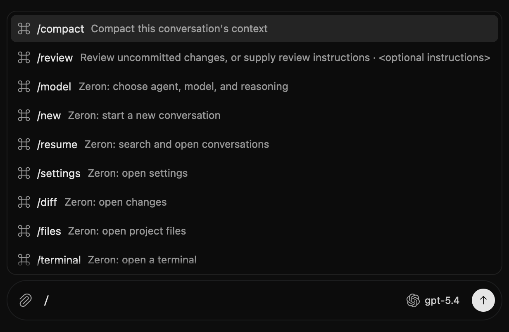
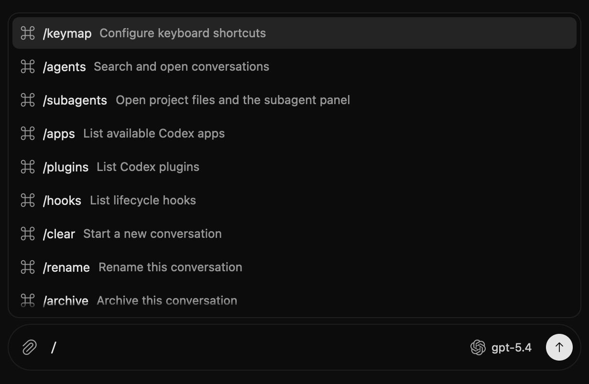
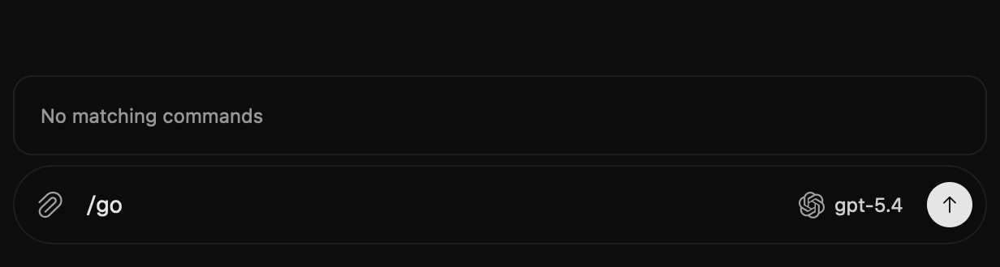
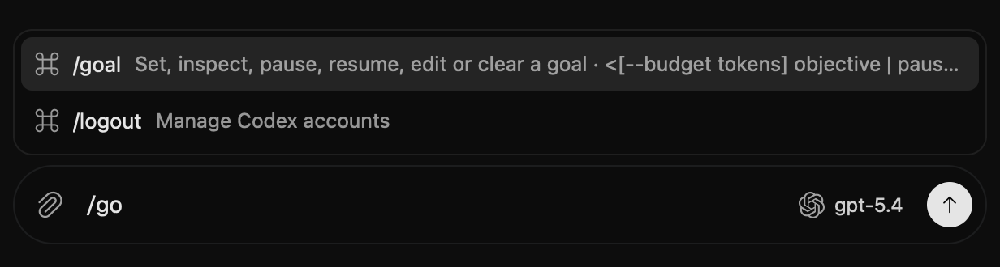

# PR #13 desktop comparison captures

These are native GPUI composer/menu captures from isolated offline fixtures,
not HTML mockups or live provider-session screenshots.

- Before: `6d9db999` (the PR merge base), using that revision's composer,
  `/compact` and `/review` catalog, and existing Zeron workspace actions.
- After: `46a17fa4`, using that revision's composer and
  `zeron_harness::codex::commands::catalog()` with desktop action mapping.
- Both: dark appearance, identical synthetic Codex chat, model label `gpt-5.4`,
  680 × 540 logical-pixel viewport, 2× native rendering. No real account,
  conversation, provider request, or user data was used.
- Input `/` shows the first visible command-menu rows. This is not the entire
  expanded catalog; additional commands are reachable by scrolling/search.
- Input `/go` shows the goal search difference. `/logout` also matches the
  application's existing fuzzy search in the after image.
- Native menu animations were allowed to settle before capture. Images were
  cropped identically within each pair; colors and UI text were not edited.

The temporary capture fixtures supply catalog data and input/focus state to
actual `Composer` instances and export `HeadlessAppContext::capture_screenshot()`
using the macOS text system and Metal renderer. They do not alter production
widget rendering. Only these images and this explanation are committed.

| Input | Before | After |
| --- | --- | --- |
| `/` |  |  |
| `/go` |  |  |
