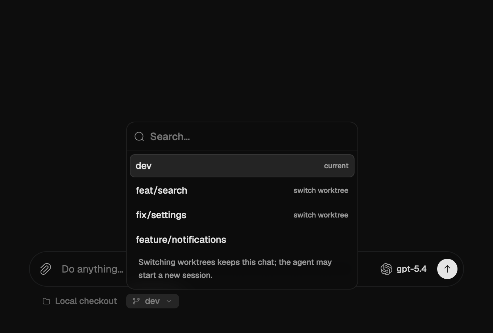

# PR #17 worktree switching — native desktop captures

These images use the real GPUI `Composer` and branch picker from `71c9eda6`.
The review fixes in `6eec3b09` do not change desktop rendering. They are native
macOS text/Metal renders, not HTML mockups or live provider-session captures.

An isolated worktree supplies fixed synthetic chat and branch data. The three
scenes show the same chat in the main checkout, in an existing `feat/search`
worktree, and with the menu closed after selecting that worktree. Scene state is
seeded directly; the pictures do not assert that a UI click performed a real Git
operation. Separate engine integration tests exercise actual worktree switching.
No real accounts, conversations or provider requests were used.

- Viewport: 680 × 460 logical pixels, 2× native capture, dark appearance.
- Menu images: identical crop `(x=0, y=300, width=1360, height=620)`.
- Closed menu: crop `(x=0, y=660, width=1360, height=240)`.
- Colors, labels and controls were not edited after capture. Animations were
  allowed to settle. Output uses `HeadlessAppContext::capture_screenshot()`.
- These are desktop screenshots. iOS/Android code and shared backend were
  reviewed, but no phone-device/simulator screenshots were captured locally.

| Main checkout menu | Existing worktree menu |
| --- | --- |
|  |  |

The selected worktree with the menu closed:

