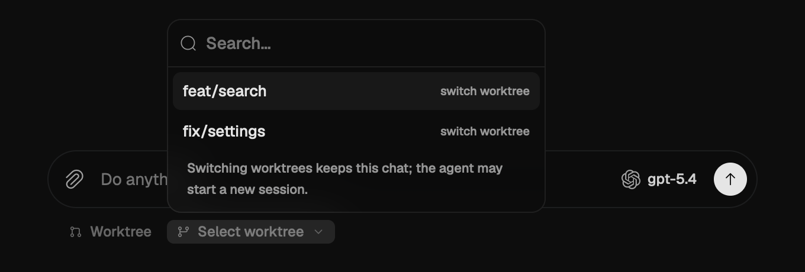
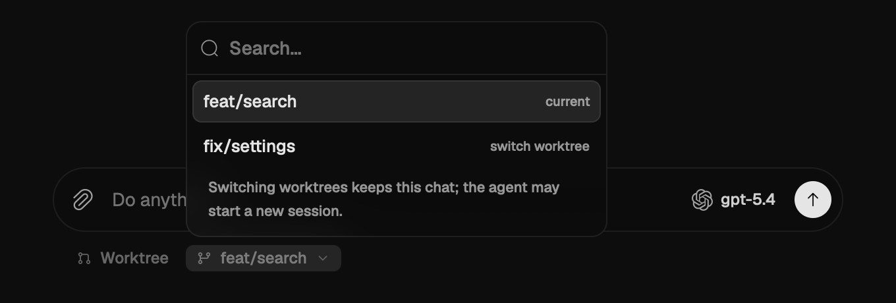
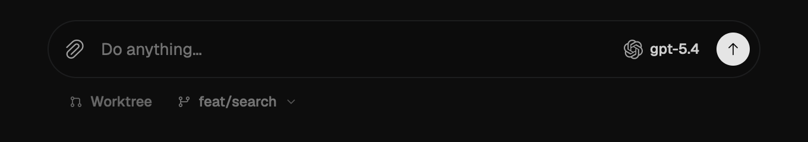

# PR #17 — existing worktrees only

Native macOS GPUI `Composer` and picker captures from `cb74623f`, rendered with
the platform text system and Metal. The menu contains only existing linked
worktrees. Main checkout and unoccupied branches are absent.

An isolated worktree supplies fixed synthetic chat/branch data. The scenes show
choosing a worktree, the same chat with `feat/search` selected, and its closed
menu. State is seeded directly; these images do not assert that a UI click ran
Git. Real worktree-to-worktree switching and rejection of invalid destinations
are verified separately by engine integration tests. No real accounts,
conversations or provider requests were used.

- Viewport: 680 × 460 logical pixels, native 2× rendering, dark appearance.
- Both open-menu images use crop `(x=0, y=440, width=1360, height=460)`.
- Closed-menu image uses crop `(x=0, y=660, width=1360, height=240)`.
- Animations were allowed to settle. Colors, labels and controls were not edited
  after capture. Output uses `HeadlessAppContext::capture_screenshot()`.
- These are desktop screenshots; phone-device/simulator screenshots were not
  captured locally.

| Choose an existing worktree | Current worktree and another destination |
| --- | --- |
|  |  |

