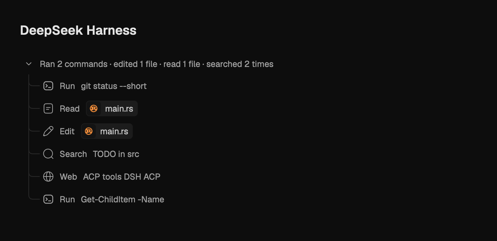
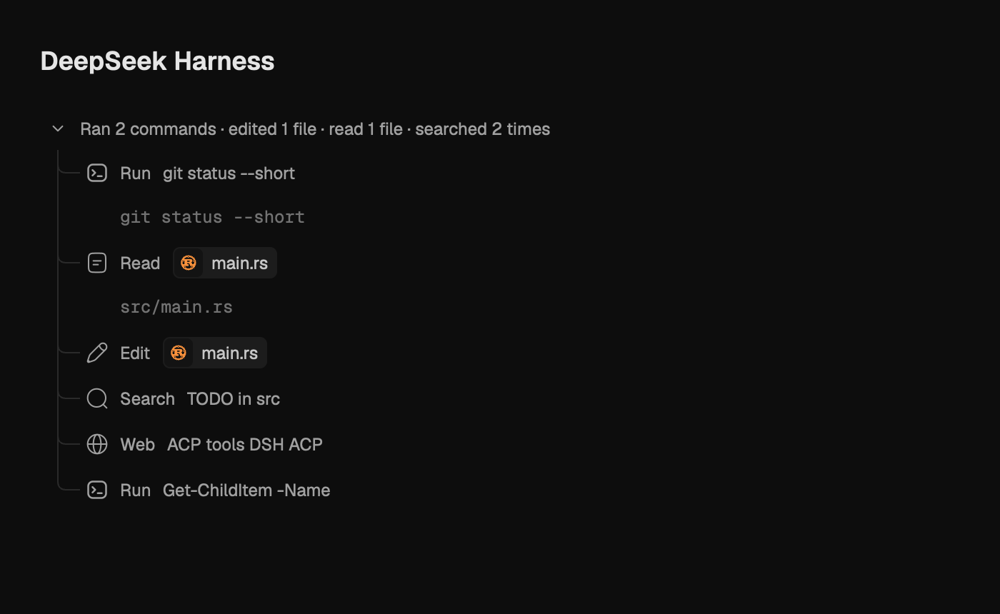

# PR #19 — Dsh tool call details

Native desktop GPUI captures from `c5a40b07`, using macOS text rendering and
Metal. The tool group, summary, icons, file chips and invocation panels are
production transcript components. The DeepSeek Harness heading is fixture
framing; these are component captures, not screenshots of a live account.

The data comes from running `dsh_tool_details_survive_transcript_sanitization`
with the offline ACP subprocess fixture. A temporary capture hook exports the
persisted, sanitized tool records, and the native renderer reads those records.
The images show six representative calls: bash, read, edit, grep, web search and
PowerShell. Tool inputs are not manually substituted in the rendered rows.

- `tool-summaries.png`: tool group open, individual calls collapsed.
- `expanded-details.png`: same records, with command and read-path invocations
  expanded. The expanded text is call information, not tool output.
- Dark appearance; 700 logical pixels wide, 340/430 logical pixels tall;
  native 2× output. No cropping, recoloring or text editing after capture.
- Fold states are preset, animations settle, and
  `HeadlessAppContext::capture_screenshot()` exports the images.
- Both the engine integration test and native capture test passed. The images
  were visually inspected for readable summaries, full invocation text and
  clipping. No live provider request or phone UI capture was performed.

## Tool summaries

## Expanded call details

